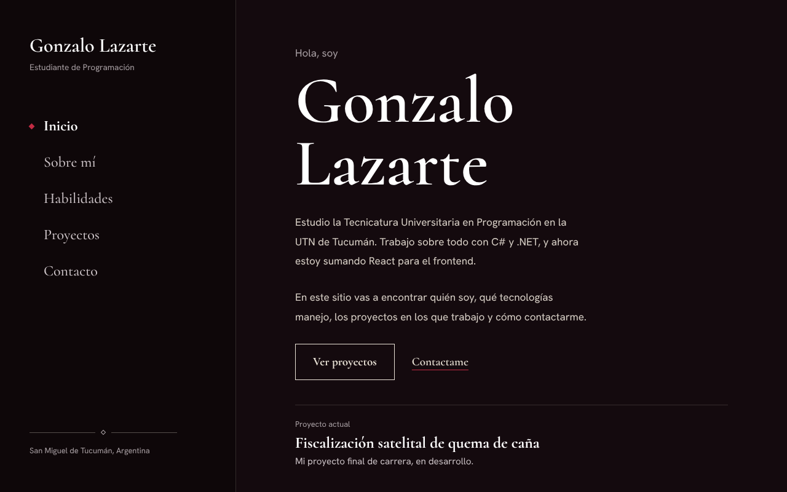
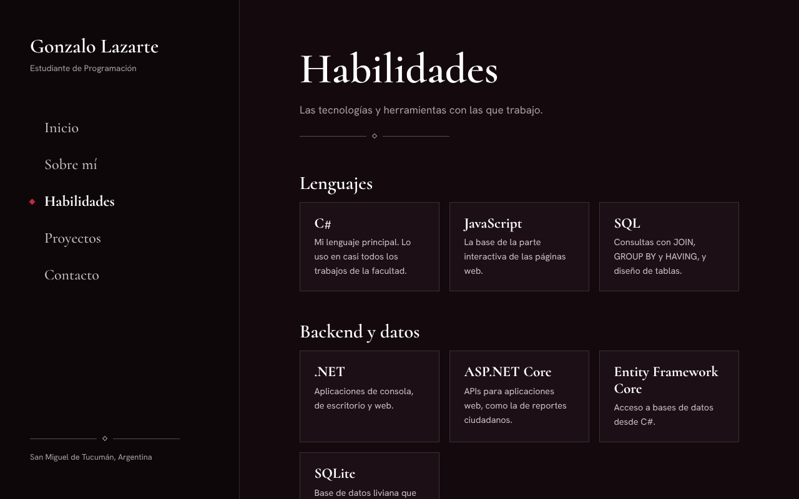
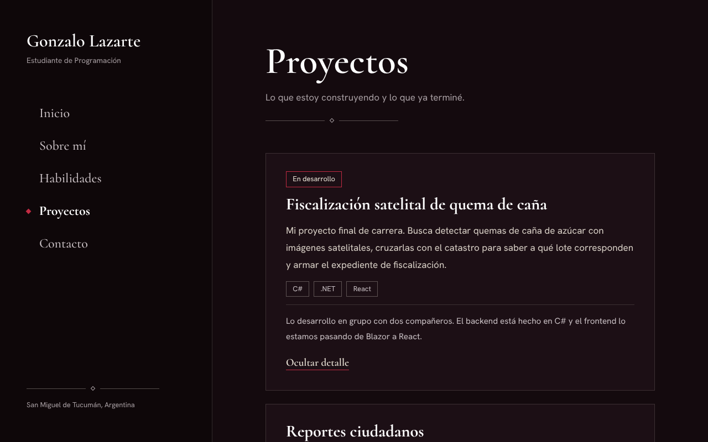

# TP2 – Mi portfolio multipágina con React Router DOM

- **Alumno:** Gonzalo Romeo Lazarte
- **Comisión:** 7
- **Materia:** Programación 4 – UTN, Facultad Regional Tucumán

## Descripción

Portfolio personal multipágina hecho con React y Vite. Es la continuación del portfolio del TP1, transformado en una aplicación con varias páginas.

La pantalla se divide en un menú lateral fijo, que ocupa el 30 % del ancho, y un área de contenido, que ocupa el 70 % restante. Al elegir una opción del menú, el contenido cambia según la ruta, sin recargar el sitio. La opción activa del menú se marca con un rombo carmesí.

## Páginas

| Página | Ruta | Contenido |
| --- | --- | --- |
| Inicio | `/` | Nombre, presentación, perfil e introducción al sitio |
| Sobre mí | `/about` | Presentación, perfil, intereses, objetivos y formación |
| Habilidades | `/skills` | Tecnologías y herramientas agrupadas por categoría |
| Proyectos | `/projects` | Tres proyectos con su descripción y tecnologías |
| Contacto | `/contact` | Correo, GitHub y ubicación |

## Tecnologías utilizadas

- React
- Vite
- React Router DOM
- JavaScript (JSX)
- CSS
- Fuentes Cormorant y Hanken Grotesk, instaladas con Fontsource

## Conceptos de React aplicados

- **Rutas:** `BrowserRouter`, `Routes` y `Route` en `App.jsx`.
- **Enlaces:** `NavLink` en el menú lateral, que marca la página activa, y `Link` en los botones de Inicio.
- **Componentes propios:** `Sidebar`, `Header`, `SkillCard`, `ProjectCard`, `ContactItem` y `Ornamento`, además de las cinco páginas.
- **Props:** el menú recibe el nombre y la profesión, cada página recibe su título en `Header`, y cada tarjeta recibe sus datos.
- **Arrays, map() y key:** los datos están en `src/data` y se recorren con `map()`, con una `key` única por elemento.
- **Eventos y useState:** el botón "Ver detalle" de cada proyecto y el botón "Ver mi experiencia" de Sobre mí muestran u ocultan información.
- **Renderizado condicional:** el detalle de cada proyecto, la experiencia en Sobre mí y la etiqueta "En desarrollo".

## Estructura del proyecto

```
src/
├── components/
│   ├── ContactItem.jsx
│   ├── Header.jsx
│   ├── Ornamento.jsx
│   ├── ProjectCard.jsx
│   ├── Sidebar.jsx
│   └── SkillCard.jsx
├── data/
│   ├── contactos.js
│   ├── formacion.js
│   ├── habilidades.js
│   └── proyectos.js
├── pages/
│   ├── About.jsx
│   ├── Contact.jsx
│   ├── Home.jsx
│   ├── Projects.jsx
│   └── Skills.jsx
├── App.jsx
├── index.css
└── main.jsx
```

## Instalación

1. Clonar el repositorio:

   ```bash
   git clone https://github.com/Tutu-04/tp2-com7-lazarte-gonzalo.git
   ```

2. Entrar a la carpeta:

   ```bash
   cd tp2-com7-lazarte-gonzalo
   ```

3. Instalar las dependencias:

   ```bash
   npm install
   ```

## Ejecución

```bash
npm run dev
```

Después, abrir en el navegador la dirección que muestra la terminal (por defecto, http://localhost:5173).

## Capturas

### Inicio



### Habilidades



### Proyectos, con el detalle abierto



## Repositorio

https://github.com/Tutu-04/tp2-com7-lazarte-gonzalo
